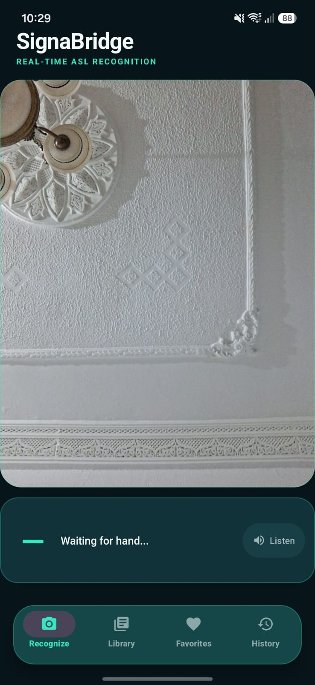
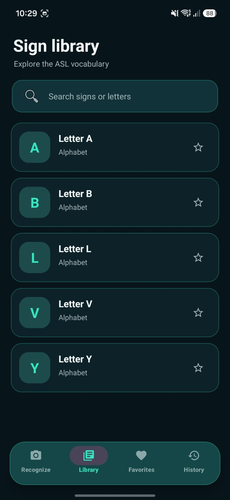
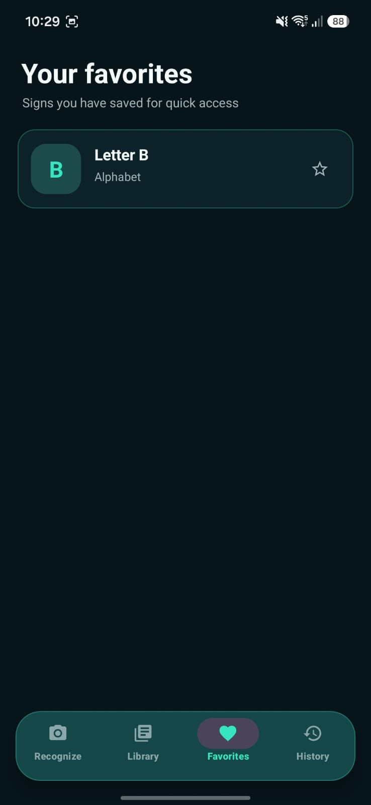
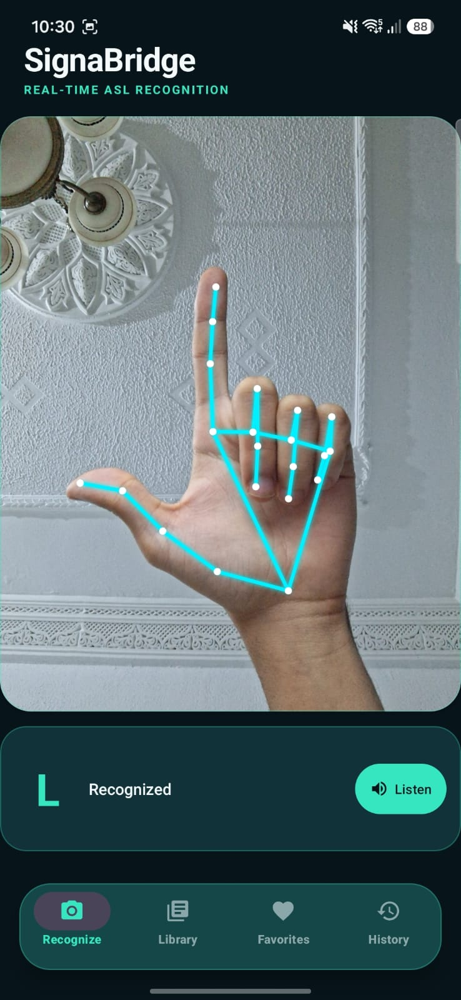
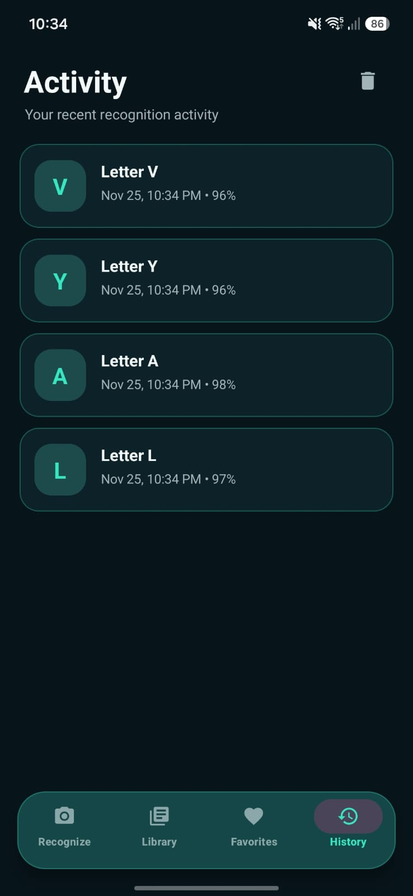
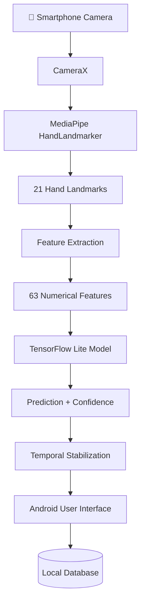

<div align="center">

# 🤟 SignaBridge

### Breaking Communication Barriers Through Artificial Intelligence

**An Offline Android Application for American Sign Language Hand Gesture Recognition**

<br/>


<br/>

**Java · Android SDK · CameraX · MediaPipe · TensorFlow Lite · Python**

<br/>

[Features](#-key-features) ·
[Architecture](#-system-architecture) ·
[Machine Learning](#-machine-learning) ·
[Installation](#-getting-started) ·
[Roadmap](#-roadmap)

</div>

---

## 📌 Overview

**SignaBridge** is an offline-first Android application that uses computer vision and machine learning to recognize selected American Sign Language (ASL) hand gestures through a smartphone camera.

The application captures hand movements, extracts anatomical hand landmarks, transforms them into numerical features, and uses a trained neural network to classify the gesture directly on the device.

Unlike cloud-dependent recognition systems, SignaBridge performs its core recognition pipeline locally, without requiring an internet connection or a remote inference server.

### 🎯 Project Objective

To explore how mobile development, computer vision, and artificial intelligence can be combined to create an accessible, lightweight, and privacy-conscious sign language recognition experience.

### 🔤 Supported Vocabulary — V1

<div align="center">

| Gesture | Class |
|:---:|:---:|
| ✊ | **A** |
| ✋ | **B** |
| 🤟 | **L** |
| ✌️ | **V** |
| 🤙 | **Y** |

**5 static ASL hand gesture classes**

</div>

> **Scope:** Version 1 focuses on five selected static hand gestures. It is not a complete ASL translation system.

---

## 📱 Application Screenshots

The following screenshots show the current Android application interface.

<div align="center">

### Real-time Recognition — Waiting for a Hand


### Sign Library


### Favorites


### Real-time Recognition — Detected Gesture


### Recognition History


</div>

> Screenshots are captured from the running SignaBridge Android application. They illustrate the implemented recognition, library, favorites, and history interfaces.

---

## ✨ Key Features

| Feature | Description |
|---|---|
| 📷 Live Camera | Real-time camera preview using CameraX |
| 🖐️ Hand Detection | Hand landmark detection with MediaPipe |
| 🧠 AI Recognition | On-device gesture classification using TensorFlow Lite |
| 🔢 Landmark Extraction | 21 hand landmarks converted into 63 numerical features |
| 🎯 Confidence Score | Displays the model's prediction confidence |
| 🔄 Prediction Stabilization | Temporal voting to reduce unstable predictions |
| 🚫 Unknown Rejection | Rejects predictions that do not satisfy recognition criteria |
| 📚 Gesture Library | Interface for exploring supported gestures |
| ⭐ Favorites | Local organization of favorite gestures |
| 🕘 Recognition History | Local recognition history |
| 📡 Offline Processing | Core AI inference works without a remote server |

*Application interface modules and optional features should be checked against the current implementation.*

---

## 🏗️ System Architecture

SignaBridge uses a modular processing pipeline that connects Android camera capture, hand tracking, feature engineering, and neural network inference.



### Recognition Pipeline

**1. Image Capture**

CameraX provides camera frames to the recognition pipeline.

**2. Hand Detection**

MediaPipe HandLandmarker identifies the hand and extracts 21 landmarks.

**3. Feature Engineering**

Each landmark contains three coordinates:

`21 landmarks × 3 coordinates = 63 features`

The feature extractor normalizes landmark coordinates relative to the wrist and applies scale normalization.

**4. Classification**

The TensorFlow Lite neural network receives the 63-dimensional feature vector and predicts one of the five supported classes.

**5. Prediction Stabilization**

A temporal voting mechanism reduces fluctuations between consecutive predictions.

**6. User Feedback**

The Android interface displays the recognized gesture and its confidence.

---

## 🧠 Machine Learning

The recognition model was developed using Python and TensorFlow/Keras, then exported to TensorFlow Lite for Android deployment.

### Dataset

The project uses the **ASL-HG American Sign Language Hand Gesture Image Dataset**.

| Parameter | Value |
|---|---:|
| Original dataset images | ~36,000 |
| Original gesture classes | 36 |
| Selected V1 classes | 5 |
| Selected images | 5,000 |
| Participants | 10 |

### Experimental Data Split

The dataset was divided by participant rather than randomly mixing images from the same participants across all subsets.

| Subset | Participants | Images |
|---|---|---:|
| Training | P1–P6 | 3,000 |
| Validation | P7–P8 | 1,000 |
| Test | P9–P10 | 1,000 |
| **Total** | **10** | **5,000** |

This participant-independent evaluation provides a more meaningful test of generalization to people not represented in training.

### Neural Network Architecture

The trained classifier uses the following architecture:

```text
Input Layer:       63 features
       ↓
Dense Layer:       64 neurons + ReLU
       ↓
Dropout:           0.10
       ↓
Dense Layer:       32 neurons + ReLU
       ↓
Dropout:           0.10
       ↓
Output Layer:      5 gesture classes
```

Training configuration includes:

- Optimizer: Adam
- Learning rate: 0.001
- Loss: Sparse Categorical Crossentropy with label smoothing
- Label smoothing: 0.05
- Early stopping: Patience of 10 epochs

### 📊 Experimental Results

<div align="center">

| Metric | Test Result |
|:---|:---:|
| **Accuracy** | **100%** |
| Macro Precision | 100% |
| Macro Recall | 100% |
| Macro F1-score | 100% |
| Test Samples | 1,000 |

</div>

Each gesture class contains 200 test images.

### Prediction Calibration

| Parameter | Result |
|---|---:|
| Recommended confidence threshold | 94.8849% |
| Target prediction retention | 93.1% |
| Unknown proxy rejection | 91.13% |
| Temporal voting | 7 of 10 predictions |

The unknown proxy evaluation uses examples from 31 ASL-HG classes excluded from V1.

> ⚠️ **Scientific note:** The 100% accuracy represents evaluation on the held-out dataset test split. It does not establish 100% recognition accuracy in real-world smartphone camera conditions. The unknown proxy results are also limited to the selected dataset classes.

---

## 🛠️ Technology Stack

### Android Development

| Technology | Responsibility |
|---|---|
| Java | Application logic |
| Android SDK | Native Android development |
| XML | User interface layouts |
| AndroidX | Android application components |
| Material Design | UI components and visual consistency |

### Computer Vision

| Technology | Responsibility |
|---|---|
| CameraX | Camera access and frame processing |
| MediaPipe Tasks Vision | Hand landmark detection |
| HandLandmarker | 21-point hand tracking |

### Artificial Intelligence

| Technology | Responsibility |
|---|---|
| Python | ML development |
| TensorFlow | Machine learning framework |
| Keras | Neural network training |
| TensorFlow Lite | Mobile inference |
| NumPy | Numerical feature processing |

### Local Storage

| Technology | Responsibility |
|---|---|
| Room / SQLite | Local structured data storage |

---

## 📂 Project Structure

```text
SignaBridge/
│
├── android/
│   ├── app/
│   │   └── src/
│   │       └── main/
│   │           ├── assets/
│   │           │   ├── hand_landmarker.task
│   │           │   └── gesture_classifier.tflite
│   │           ├── java/
│   │           └── res/
│   ├── build.gradle
│   ├── settings.gradle
│   └── gradlew
│
├── tools/
│   ├── train.py
│   ├── evaluate.py
│   ├── prepare_dataset.py
│   ├── extract_landmarks.py
│   ├── extract_landmarks_batch.py
│   ├── feature_extractor.py
│   ├── export_tflite.py
│   ├── inspect_dataset.py
│   ├── make_parity_vectors.py
│   ├── feature_contract.md
│   ├── requirements.txt
│   └── README.md
│
├── docs/
│   └── screenshots/
│
├── ML_README.md
├── README.md
└── .gitignore
```

---

## 🚀 Getting Started

### Prerequisites

- Android Studio
- Android SDK
- JDK compatible with the project's Gradle configuration
- Python 3
- Git
- An Android device or emulator with camera support

### 1. Clone the Repository

```bash
git clone https://github.com/Oussema-gif/SignaBridge.git

cd SignaBridge
```

### 2. Open the Android Project

Open the `android/` directory in Android Studio.

Allow Gradle to synchronize the project and download the required dependencies.

### 3. Build the Application

On Linux:

```bash
cd android

chmod +x gradlew

./gradlew assembleDebug
```

### 4. Install on an Android Device

Connect an Android device with USB debugging enabled:

```bash
./gradlew installDebug
```

Grant camera permission when requested.

### 5. Run the Application

Launch SignaBridge from the Android application launcher.

> Note: The exact minimum Android version and device compatibility depend on the current Gradle configuration and Android manifest.

---

## 🧪 Machine Learning Development

The `tools/` directory contains the Python training, evaluation, and feature engineering pipeline.

To prepare the Python environment:

```bash
cd tools

python3 -m venv .venv

source .venv/bin/activate

pip install -r requirements.txt
```

The original dataset is not included in this repository.

Place the dataset in the expected directory structure described in `tools/README.md` before running the dataset preparation and training pipeline.

Refer to the ML documentation for the exact execution sequence.

---

## 🔒 Offline Processing & Privacy

SignaBridge is designed to perform its core recognition operations directly on the Android device.

- Camera frames are processed locally.
- Hand landmarks are extracted locally.
- The TensorFlow Lite model runs on-device.
- No remote inference server is required.
- Local application data is stored on the device.

The application does not require an internet connection for its core recognition pipeline.

---

## ⚠️ Current Limitations

- Only five static ASL gestures are supported.
- Dynamic sign recognition is outside the current V1 scope.
- Real-world recognition requires broader device and user testing.
- Lighting, camera quality, hand orientation, and occlusion may affect detection.
- Five letters do not represent the complete American Sign Language vocabulary or grammar.

---

## 🗺️ Roadmap

- [x] Native Android application foundation
- [x] Camera integration
- [x] MediaPipe hand landmark extraction
- [x] Five-class gesture classifier
- [x] TensorFlow Lite model export
- [x] Offline inference pipeline
- [ ] Expand supported ASL vocabulary
- [ ] Improve real-world robustness
- [ ] Add dynamic gesture recognition
- [ ] Conduct broader user testing
- [ ] Further improve accessibility

---

## 🎓 Academic Information

**Project:** SignaBridge  
**Type:** Projet universitaire  
**Institution:** Université de Monastir  
**Faculty:** Faculté des Sciences de Monastir  
**Field:** Computer Science  
**Student:** Rahmouni Oussema  
**Supervisor:** Kacem Khaoula  
**Academic Year:** 2026–2027

This project explores the integration of mobile software engineering, computer vision, and machine learning into an offline Android application.

---

## 👨‍💻 Author

<div align="center">

### Oussema Rahmouni

Software Engineering Student  
Université de Monastir — Tunisia

[](https://github.com/Oussema-gif)

**SignaBridge — Bridging communication through technology.**

</div>

---

<div align="center">

Made with ❤️, Java, Python, and Artificial Intelligence.

**If you find this project interesting, consider giving it a ⭐**

</div>
