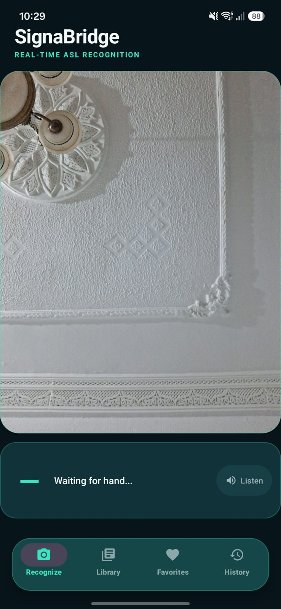
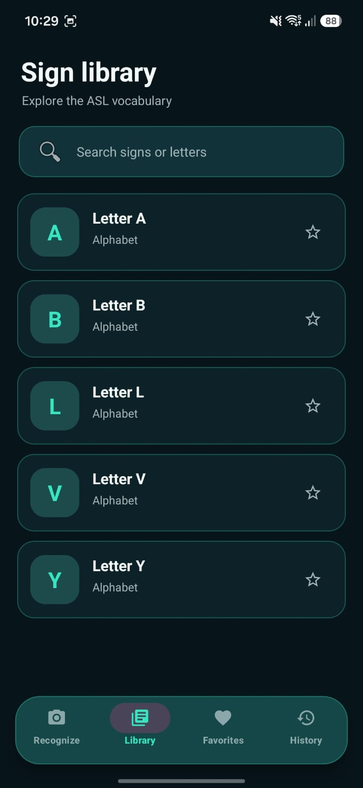
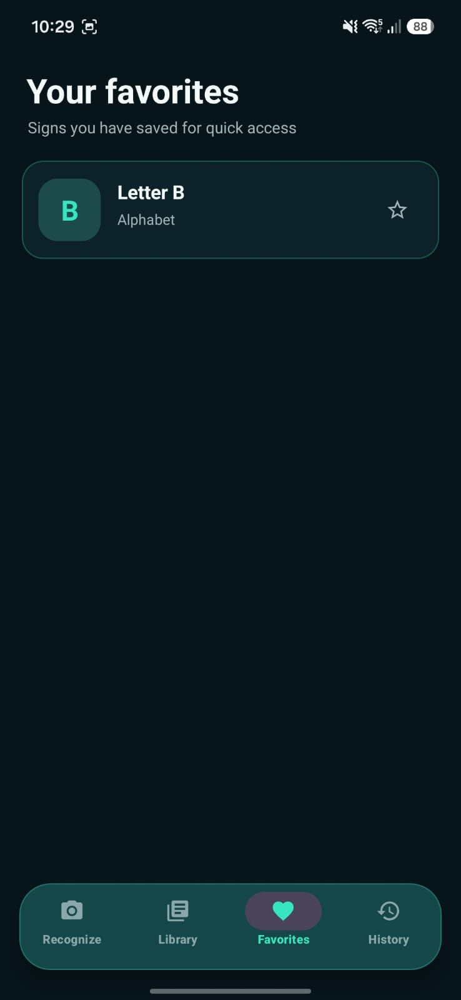
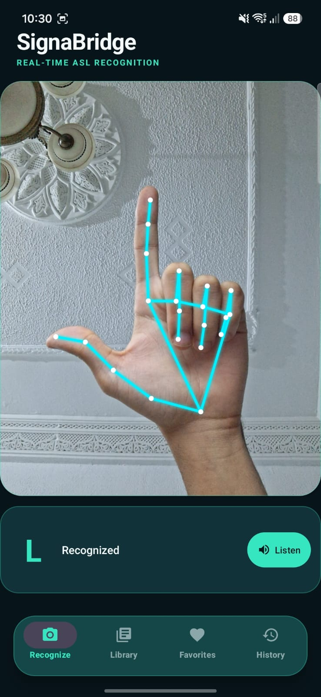
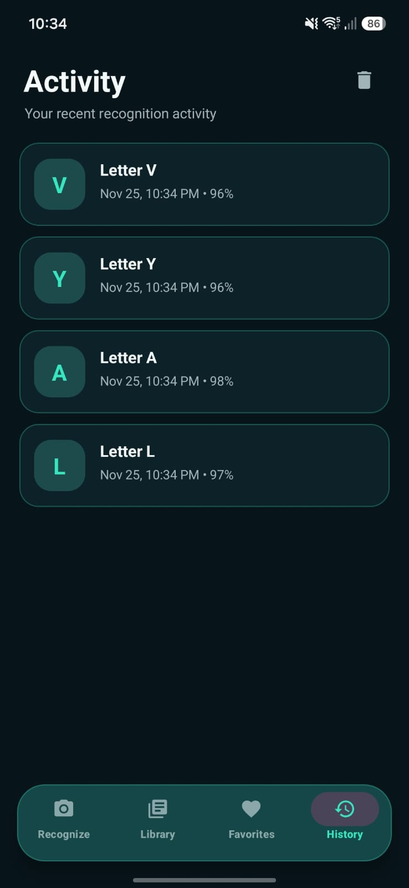

## 📱 Application Screenshots

The following screenshots show the current Android application interface.

### Real-time Recognition — Waiting for a Hand

### Sign Library

### Favorites

### Real-time Recognition — Detected Gesture

### Recognition History

> Screenshots are captured from the running SignaBridge Android application. They illustrate the implemented recognition, library, favorites, and history interfaces.
